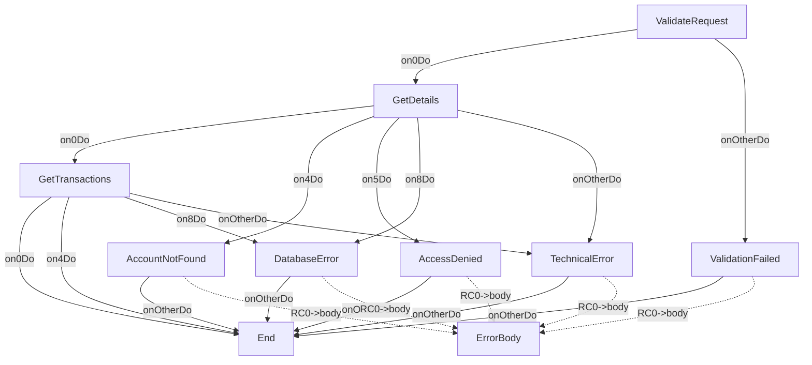

# GetAccountDetailsOp

---
entity_type: operation
entity_id: GetAccountDetailsOp
conversion_status: not_started
entry_step: ValidateRequest
channel: INTERNET
host_key: GACD
source_file: C:\GitHub\shaybc\snapir\bank-demo\composer\Workspace\WSBCC_INTERNET\src\Xml Definition\Channel\INTERNET\selfDefOper\GetAccountDetails.xml
source_hash: 3b0a5c48426c37795e96fa132e1ae902d2a7f7181f2e3d60a7754a1b644d83f7
---

## Context
- [GetAccountDetailsCtxt](contexts/GetAccountDetailsCtxt.md)

## Shared Components
- 3 shared components
- format StandardErrorRSFmt: [StandardErrorRSFmt](formats/StandardErrorRSFmt.md)
- implClass com.ibm.il.dse.operations.common.ValidateInputFields: [com.ibm.il.dse.operations.common.ValidateInputFields](classes/com/ibm/il/dse/operations/common/ValidateInputFields.md)
- implClass com.ibm.il.dse.operations.common.MapErrorByValueAlways: [com.ibm.il.dse.operations.common.MapErrorByValueAlways](classes/com/ibm/il/dse/operations/common/MapErrorByValueAlways.md)

## Operation Attributes
- writeToLog: `true`

## Steps
- [ValidateRequest](opsteps/ValidateRequest.md)
- [GetDetails](opsteps/GetDetails.md)
- [GetTransactions](opsteps/GetTransactions.md)
- [ValidationFailed](opsteps/ValidationFailed.md)
- [AccountNotFound](opsteps/AccountNotFound.md)
- [AccessDenied](opsteps/AccessDenied.md)
- [DatabaseError](opsteps/DatabaseError.md)
- [TechnicalError](opsteps/TechnicalError.md)

## Request Format
- [GetAccountDetailsRQFmt](formats/GetAccountDetailsRQFmt.md)

## Reply Format
- [GetAccountDetailsRSFmt](formats/GetAccountDetailsRSFmt.md)

## Other Formats
- csErrorReplyFormat: [StandardErrorRSFmt](formats/StandardErrorRSFmt.md)

## Java Dependencies
- [com.ibm.il.dse.operations.common.ValidateInputFields](classes/com/ibm/il/dse/operations/common/ValidateInputFields.md)
- [com.ibm.il.dse.operations.internet.db.GetAccountDetailsSP](classes/com/ibm/il/dse/operations/internet/db/GetAccountDetailsSP.md)
- [com.ibm.il.dse.operations.internet.db.GetAccountTransactionsSP](classes/com/ibm/il/dse/operations/internet/db/GetAccountTransactionsSP.md)
- [com.ibm.il.dse.operations.common.MapErrorByValueAlways](classes/com/ibm/il/dse/operations/common/MapErrorByValueAlways.md)
- [com.ibm.il.dse.operations.common.MapErrorByValueAlways](classes/com/ibm/il/dse/operations/common/MapErrorByValueAlways.md)
- [com.ibm.il.dse.operations.common.MapErrorByValueAlways](classes/com/ibm/il/dse/operations/common/MapErrorByValueAlways.md)
- [com.ibm.il.dse.operations.common.MapErrorByValueAlways](classes/com/ibm/il/dse/operations/common/MapErrorByValueAlways.md)
- [com.ibm.il.dse.operations.common.MapErrorByValueAlways](classes/com/ibm/il/dse/operations/common/MapErrorByValueAlways.md)

## Flow Diagram

