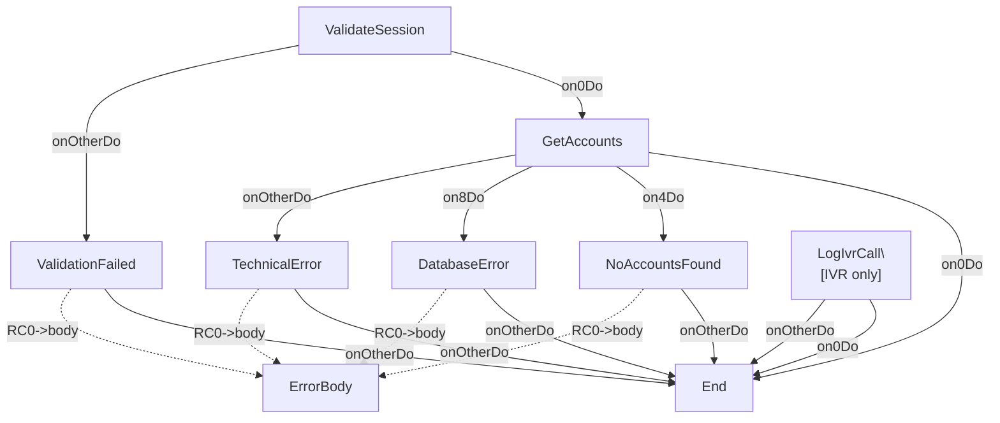

# GetClientAccountsOp

---
entity_type: operation
entity_id: GetClientAccountsOp
conversion_status: not_started
entry_step: ValidateSession
channel: INTERNET
host_key: GCAC
source_file: C:\GitHub\shaybc\snapir\bank-demo\composer\Workspace\WSBCC_INTERNET\src\Xml Definition\Channel\INTERNET\selfDefOper\GetClientAccounts.xml
source_hash: c6d10b4ed4d931e4e2933f6afeb7d68804cec3db9f1e488ea24a74b332d31bb8
---

## Context
- [GetClientAccountsCtxt](contexts/GetClientAccountsCtxt.md)

## Shared Components
- 3 shared components
- format StandardErrorRSFmt: [StandardErrorRSFmt](formats/StandardErrorRSFmt.md)
- implClass com.ibm.il.dse.operations.common.ValidateInputFields: [com.ibm.il.dse.operations.common.ValidateInputFields](classes/com/ibm/il/dse/operations/common/ValidateInputFields.md)
- implClass com.ibm.il.dse.operations.common.MapErrorByValueAlways: [com.ibm.il.dse.operations.common.MapErrorByValueAlways](classes/com/ibm/il/dse/operations/common/MapErrorByValueAlways.md)

## Operation Attributes
- operationFields: `CHANNEL_ID=INTERNET`
- writeToLog: `true`

## Steps
- [ValidateSession](opsteps/ValidateSession.md)
- [GetAccounts](opsteps/GetAccounts.md)
- [NoAccountsFound](opsteps/NoAccountsFound.md)
- [ValidationFailed](opsteps/ValidationFailed.md)
- [DatabaseError](opsteps/DatabaseError.md)
- [TechnicalError](opsteps/TechnicalError.md)
- [LogIvrCall](opsteps/LogIvrCall.md) *(onlyFor: IVR)*

## Request Format
- [GetClientAccountsRQFmt](formats/GetClientAccountsRQFmt.md)

## Reply Format
- [GetClientAccountsRSFmt](formats/GetClientAccountsRSFmt.md)

## Other Formats
- csErrorReplyFormat: [StandardErrorRSFmt](formats/StandardErrorRSFmt.md)

## Java Dependencies
- [com.ibm.il.dse.operations.common.ValidateInputFields](classes/com/ibm/il/dse/operations/common/ValidateInputFields.md)
- [com.ibm.il.dse.operations.internet.db.GetClientAccountsSP](classes/com/ibm/il/dse/operations/internet/db/GetClientAccountsSP.md)
- [com.ibm.il.dse.operations.common.MapErrorByValueAlways](classes/com/ibm/il/dse/operations/common/MapErrorByValueAlways.md)
- [com.ibm.il.dse.operations.common.MapErrorByValueAlways](classes/com/ibm/il/dse/operations/common/MapErrorByValueAlways.md)
- [com.ibm.il.dse.operations.common.MapErrorByValueAlways](classes/com/ibm/il/dse/operations/common/MapErrorByValueAlways.md)
- [com.ibm.il.dse.operations.common.MapErrorByValueAlways](classes/com/ibm/il/dse/operations/common/MapErrorByValueAlways.md)
- [com.ibm.il.dse.operations.ivr.db.LogIvrSession](classes/com/ibm/il/dse/operations/ivr/db/LogIvrSession.md)

## Flow Diagram

