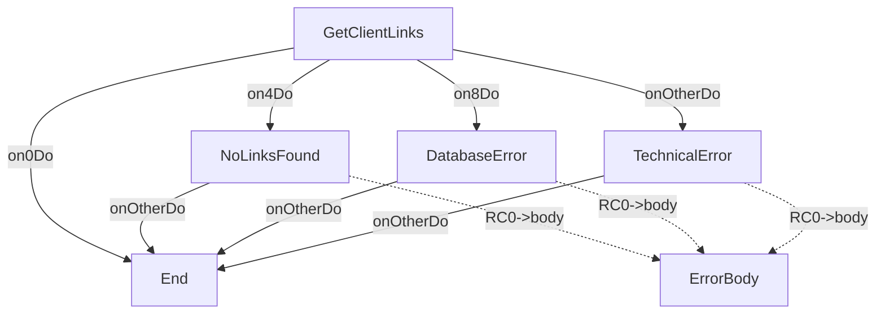

# GetClientLinksOp

---
entity_type: operation
entity_id: GetClientLinksOp
conversion_status: not_started
entry_step: GetClientLinks
channel: INTERNET
host_key: GCLN
source_file: C:\GitHub\shaybc\snapir\bank-demo\composer\Workspace\WSBCC_INTERNET\src\Xml Definition\Channel\INTERNET\selfDefOper\GetClientLinks.xml
source_hash: 5e8b0678d1d4e8c4d53ee6e1e39a933baff92bdd194e0ec8b9634c6d93faac88
---

## Context
- [GetClientLinksCtxt](contexts/GetClientLinksCtxt.md)

## Shared Components
- 5 shared components
- context GetClientLinksCtxt: [GetClientLinksCtxt](contexts/GetClientLinksCtxt.md)
- format GetClientLinksRQFmt: [GetClientLinksRQFmt](formats/GetClientLinksRQFmt.md)
- format GetClientLinksRSFmt: [GetClientLinksRSFmt](formats/GetClientLinksRSFmt.md)
- format StandardErrorRSFmt: [StandardErrorRSFmt](formats/StandardErrorRSFmt.md)
- implClass com.ibm.il.dse.operations.common.MapErrorByValueAlways: [com.ibm.il.dse.operations.common.MapErrorByValueAlways](classes/com/ibm/il/dse/operations/common/MapErrorByValueAlways.md)

## Operation Attributes
- writeToLog: `false`

## Steps
- [GetClientLinks](opsteps/GetClientLinks.md)
- [NoLinksFound](opsteps/NoLinksFound.md)
- [DatabaseError](opsteps/DatabaseError.md)
- [TechnicalError](opsteps/TechnicalError.md)

## Request Format
- [GetClientLinksRQFmt](formats/GetClientLinksRQFmt.md)

## Reply Format
- [GetClientLinksRSFmt](formats/GetClientLinksRSFmt.md)

## Other Formats
- csErrorReplyFormat: [StandardErrorRSFmt](formats/StandardErrorRSFmt.md)

## Java Dependencies
- [com.ibm.il.dse.operations.internet.db.GetClientLinksSP](classes/com/ibm/il/dse/operations/internet/db/GetClientLinksSP.md)
- [com.ibm.il.dse.operations.common.MapErrorByValueAlways](classes/com/ibm/il/dse/operations/common/MapErrorByValueAlways.md)
- [com.ibm.il.dse.operations.common.MapErrorByValueAlways](classes/com/ibm/il/dse/operations/common/MapErrorByValueAlways.md)
- [com.ibm.il.dse.operations.common.MapErrorByValueAlways](classes/com/ibm/il/dse/operations/common/MapErrorByValueAlways.md)

## Flow Diagram

