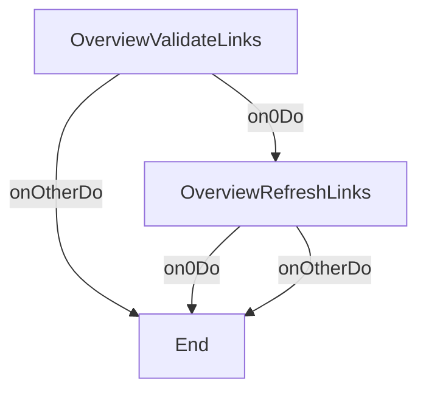

# GetClientOverviewOp

---
entity_type: operation
entity_id: GetClientOverviewOp
conversion_status: not_started
entry_step: OverviewValidateLinks
channel: INTERNET
source_file: C:\GitHub\shaybc\snapir\bank-demo\composer\Workspace\WSBCC_INTERNET\src\Xml Definition\Channel\INTERNET\selfDefOper\GetClientOverview.xml
source_hash: ded99002c19ffea1f8809b324234983e6d5dafb41ae976a7e89bc2d092703dff
---

## Context
- [GetClientLinksCtxt](contexts/GetClientLinksCtxt.md)

## Shared Components
- 5 shared components
- context GetClientLinksCtxt: [GetClientLinksCtxt](contexts/GetClientLinksCtxt.md)
- format GetClientLinksRQFmt: [GetClientLinksRQFmt](formats/GetClientLinksRQFmt.md)
- format GetClientLinksRSFmt: [GetClientLinksRSFmt](formats/GetClientLinksRSFmt.md)
- format StandardErrorRSFmt: [StandardErrorRSFmt](formats/StandardErrorRSFmt.md)
- implClass com.ibm.il.dse.cc.cut.CCComplexOpStep: [com.ibm.il.dse.cc.cut.CCComplexOpStep](classes/com/ibm/il/dse/cc/cut/CCComplexOpStep.md)

## Steps
- [OverviewValidateLinks](opsteps/OverviewValidateLinks.md)
- [OverviewRefreshLinks](opsteps/OverviewRefreshLinks.md)

## Request Format
- [GetClientLinksRQFmt](formats/GetClientLinksRQFmt.md)

## Reply Format
- [GetClientLinksRSFmt](formats/GetClientLinksRSFmt.md)

## Other Formats
- csErrorReplyFormat: [StandardErrorRSFmt](formats/StandardErrorRSFmt.md)

## Java Dependencies
- [com.ibm.il.dse.cc.cut.CCComplexOpStep](classes/com/ibm/il/dse/cc/cut/CCComplexOpStep.md)
- [com.ibm.il.dse.cc.cut.CCComplexOpStep](classes/com/ibm/il/dse/cc/cut/CCComplexOpStep.md)

## Flow Diagram

