# TransferFundsOp

---
entity_type: operation
entity_id: TransferFundsOp
conversion_status: not_started
entry_step: ValidateTransfer
channel: INTERNET
host_key: TRFR
source_file: C:\GitHub\shaybc\snapir\bank-demo\composer\Workspace\WSBCC_INTERNET\src\Xml Definition\Channel\INTERNET\selfDefOper\TransferFunds.xml
source_hash: 71e86b8b16811414061e81e82a1634ea9ae2dad8c37da555c01db40a4c5c8ba5
---

## Context
- [TransferFundsCtxt](contexts/TransferFundsCtxt.md)

## Shared Components
- 3 shared components
- format StandardErrorRSFmt: [StandardErrorRSFmt](formats/StandardErrorRSFmt.md)
- implClass com.ibm.il.dse.operations.common.ValidateInputFields: [com.ibm.il.dse.operations.common.ValidateInputFields](classes/com/ibm/il/dse/operations/common/ValidateInputFields.md)
- implClass com.ibm.il.dse.operations.common.MapErrorByValueAlways: [com.ibm.il.dse.operations.common.MapErrorByValueAlways](classes/com/ibm/il/dse/operations/common/MapErrorByValueAlways.md)

## Operation Attributes
- operationFields: `CHANNEL_ID=INTERNET,MAX_RETRY=3`
- writeToLog: `true`
- writeToOfecStat: `true`

## Initial Values (iniValue)
- `TransferStatus=PENDING`
- `FraudScore=0`

## Steps
- [ValidateTransfer](opsteps/ValidateTransfer.md)
- [CheckLimits](opsteps/CheckLimits.md)
- [FraudCheck](opsteps/FraudCheck.md)
- [SkipFraudOnTimeout](opsteps/SkipFraudOnTimeout.md)
- [ExecuteTransfer](opsteps/ExecuteTransfer.md)
- [ValidationFailed](opsteps/ValidationFailed.md)
- [InsufficientFunds](opsteps/InsufficientFunds.md)
- [DailyLimitExceeded](opsteps/DailyLimitExceeded.md)
- [AccountNotEligible](opsteps/AccountNotEligible.md)
- [FraudSuspected](opsteps/FraudSuspected.md)
- [CoreBankingRejected](opsteps/CoreBankingRejected.md)
- [TransferAlreadyProcessed](opsteps/TransferAlreadyProcessed.md)
- [DatabaseError](opsteps/DatabaseError.md)
- [TechnicalError](opsteps/TechnicalError.md)

## Request Format
- [TransferFundsRQFmt](formats/TransferFundsRQFmt.md)

## Reply Format
- [TransferFundsRSFmt](formats/TransferFundsRSFmt.md)

## Other Formats
- csErrorReplyFormat: [StandardErrorRSFmt](formats/StandardErrorRSFmt.md)

## Java Dependencies
- [com.ibm.il.dse.operations.common.ValidateInputFields](classes/com/ibm/il/dse/operations/common/ValidateInputFields.md)
- [com.ibm.il.dse.operations.internet.db.ValidateTransferLimitsSP](classes/com/ibm/il/dse/operations/internet/db/ValidateTransferLimitsSP.md)
- [com.ibm.il.dse.operations.internet.service.CallFraudDetection](classes/com/ibm/il/dse/operations/internet/service/CallFraudDetection.md)
- [com.ibm.il.dse.operations.common.SetChannelContext](classes/com/ibm/il/dse/operations/common/SetChannelContext.md)
- [com.ibm.il.dse.operations.internet.db.ExecuteTransferSP](classes/com/ibm/il/dse/operations/internet/db/ExecuteTransferSP.md)
- [com.ibm.il.dse.operations.common.MapErrorByValueAlways](classes/com/ibm/il/dse/operations/common/MapErrorByValueAlways.md)
- [com.ibm.il.dse.operations.common.MapErrorByValueAlways](classes/com/ibm/il/dse/operations/common/MapErrorByValueAlways.md)
- [com.ibm.il.dse.operations.common.MapErrorByValueAlways](classes/com/ibm/il/dse/operations/common/MapErrorByValueAlways.md)
- [com.ibm.il.dse.operations.common.MapErrorByValueAlways](classes/com/ibm/il/dse/operations/common/MapErrorByValueAlways.md)
- [com.ibm.il.dse.operations.common.MapErrorByValueAlways](classes/com/ibm/il/dse/operations/common/MapErrorByValueAlways.md)
- [com.ibm.il.dse.operations.common.MapErrorByValueAlways](classes/com/ibm/il/dse/operations/common/MapErrorByValueAlways.md)
- [com.ibm.il.dse.operations.common.MapErrorByValueAlways](classes/com/ibm/il/dse/operations/common/MapErrorByValueAlways.md)
- [com.ibm.il.dse.operations.common.MapErrorByValueAlways](classes/com/ibm/il/dse/operations/common/MapErrorByValueAlways.md)
- [com.ibm.il.dse.operations.common.MapErrorByValueAlways](classes/com/ibm/il/dse/operations/common/MapErrorByValueAlways.md)

## Flow Diagram

```mermaid
graph TD
    m_ValidateTransfer_1pb8g8x["ValidateTransfer"] -->|"on0Do"| m_CheckLimits_10t68tc["CheckLimits"]
    m_ValidateTransfer_1pb8g8x["ValidateTransfer"] -->|"onOtherDo"| m_ValidationFailed_8zi59y["ValidationFailed"]
    m_CheckLimits_10t68tc["CheckLimits"] -->|"on0Do"| m_FraudCheck_2y3b50["FraudCheck"]
    m_CheckLimits_10t68tc["CheckLimits"] -->|"on3Do"| m_DailyLimitExceeded_cqh3n9["DailyLimitExceeded"]
    m_CheckLimits_10t68tc["CheckLimits"] -->|"on4Do"| m_InsufficientFunds_xlgmp7["InsufficientFunds"]
    m_CheckLimits_10t68tc["CheckLimits"] -->|"on5Do"| m_AccountNotEligible_ia071["AccountNotEligible"]
    m_CheckLimits_10t68tc["CheckLimits"] -->|"on8Do"| m_DatabaseError_1pu6otp["DatabaseError"]
    m_CheckLimits_10t68tc["CheckLimits"] -->|"onOtherDo"| m_TechnicalError_sy098r["TechnicalError"]
    m_FraudCheck_2y3b50["FraudCheck"] -->|"on0Do"| m_ExecuteTransfer_1f6v0io["ExecuteTransfer"]
    m_FraudCheck_2y3b50["FraudCheck"] -->|"on2Do"| m_FraudSuspected_vbq9yq["FraudSuspected"]
    m_FraudCheck_2y3b50["FraudCheck"] -->|"onOtherDo"| m_TechnicalError_sy098r["TechnicalError"]
    m_FraudCheck_2y3b50["FraudCheck"] -->|"onTimeoutDo"| m_SkipFraudOnTimeout_7vsyd9["SkipFraudOnTimeout"]
    m_SkipFraudOnTimeout_7vsyd9["SkipFraudOnTimeout"] -->|"on0Do"| m_ExecuteTransfer_1f6v0io["ExecuteTransfer"]
    m_SkipFraudOnTimeout_7vsyd9["SkipFraudOnTimeout"] -->|"onOtherDo"| m_TechnicalError_sy098r["TechnicalError"]
    m_ExecuteTransfer_1f6v0io["ExecuteTransfer"] -->|"on0Do"| m_end_25ln["End"]
    m_ExecuteTransfer_1f6v0io["ExecuteTransfer"] -->|"on6Do"| m_CoreBankingRejected_1y3uz9h["CoreBankingRejected"]
    m_ExecuteTransfer_1f6v0io["ExecuteTransfer"] -->|"on7Do"| m_TransferAlreadyProcessed_e9ci69["TransferAlreadyProcessed"]
    m_ExecuteTransfer_1f6v0io["ExecuteTransfer"] -->|"on8Do"| m_DatabaseError_1pu6otp["DatabaseError"]
    m_ExecuteTransfer_1f6v0io["ExecuteTransfer"] -->|"onOtherDo"| m_TechnicalError_sy098r["TechnicalError"]
    m_ValidationFailed_8zi59y["ValidationFailed"] -->|"onOtherDo"| m_end_25ln["End"]
    m_ValidationFailed_8zi59y["ValidationFailed"] -.->|"RC0-&gt;body"| m_ErrorBody_12kzq96["ErrorBody"]
    m_InsufficientFunds_xlgmp7["InsufficientFunds"] -->|"onOtherDo"| m_end_25ln["End"]
    m_InsufficientFunds_xlgmp7["InsufficientFunds"] -.->|"RC0-&gt;body"| m_ErrorBody_12kzq96["ErrorBody"]
    m_DailyLimitExceeded_cqh3n9["DailyLimitExceeded"] -->|"onOtherDo"| m_end_25ln["End"]
    m_DailyLimitExceeded_cqh3n9["DailyLimitExceeded"] -.->|"RC0-&gt;body"| m_ErrorBody_12kzq96["ErrorBody"]
    m_AccountNotEligible_ia071["AccountNotEligible"] -->|"onOtherDo"| m_end_25ln["End"]
    m_AccountNotEligible_ia071["AccountNotEligible"] -.->|"RC0-&gt;body"| m_ErrorBody_12kzq96["ErrorBody"]
    m_FraudSuspected_vbq9yq["FraudSuspected"] -->|"onOtherDo"| m_end_25ln["End"]
    m_FraudSuspected_vbq9yq["FraudSuspected"] -.->|"RC0-&gt;body"| m_ErrorBody_12kzq96["ErrorBody"]
    m_CoreBankingRejected_1y3uz9h["CoreBankingRejected"] -->|"onOtherDo"| m_end_25ln["End"]
    m_CoreBankingRejected_1y3uz9h["CoreBankingRejected"] -.->|"RC0-&gt;body"| m_ErrorBody_12kzq96["ErrorBody"]
    m_TransferAlreadyProcessed_e9ci69["TransferAlreadyProcessed"] -->|"onOtherDo"| m_end_25ln["End"]
    m_TransferAlreadyProcessed_e9ci69["TransferAlreadyProcessed"] -.->|"RC0-&gt;body"| m_ErrorBody_12kzq96["ErrorBody"]
    m_DatabaseError_1pu6otp["DatabaseError"] -->|"onOtherDo"| m_end_25ln["End"]
    m_DatabaseError_1pu6otp["DatabaseError"] -.->|"RC0-&gt;body"| m_ErrorBody_12kzq96["ErrorBody"]
    m_TechnicalError_sy098r["TechnicalError"] -->|"onOtherDo"| m_end_25ln["End"]
    m_TechnicalError_sy098r["TechnicalError"] -.->|"RC0-&gt;body"| m_ErrorBody_12kzq96["ErrorBody"]
```

