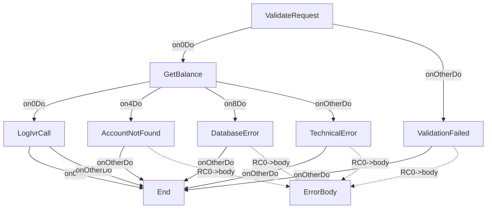

# GetAccountBalanceOp

---
entity_type: operation
entity_id: GetAccountBalanceOp
conversion_status: not_started
entry_step: ValidateRequest
channel: IVR
host_key: GBAL
source_file: C:\GitHub\shaybc\snapir\bank-demo\composer\Workspace\WSBCC_IVR\src\Xml Definition\Channel\IVR\selfDefOper\GetAccountBalance.xml
source_hash: 0fb403fd7c6dea2ff8390f4079959769b0e3c15a2c3538965bbb50b481dd4c2e
---

## Context
- [GetAccountBalanceCtxt](contexts/GetAccountBalanceCtxt.md)

## Shared Components
- 3 shared components
- format StandardErrorRSFmt: [StandardErrorRSFmt](formats/StandardErrorRSFmt.md)
- implClass com.ibm.il.dse.operations.common.ValidateInputFields: [com.ibm.il.dse.operations.common.ValidateInputFields](classes/com/ibm/il/dse/operations/common/ValidateInputFields.md)
- implClass com.ibm.il.dse.operations.common.MapErrorByValueAlways: [com.ibm.il.dse.operations.common.MapErrorByValueAlways](classes/com/ibm/il/dse/operations/common/MapErrorByValueAlways.md)

## Operation Attributes
- operationFields: `CHANNEL_ID=IVR`

## Steps
- [ValidateRequest](opsteps/ValidateRequest.md)
- [GetBalance](opsteps/GetBalance.md)
- [LogIvrCall](opsteps/LogIvrCall.md)
- [AccountNotFound](opsteps/AccountNotFound.md)
- [ValidationFailed](opsteps/ValidationFailed.md)
- [DatabaseError](opsteps/DatabaseError.md)
- [TechnicalError](opsteps/TechnicalError.md)

## Request Format
- [GetAccountBalanceRQFmt](formats/GetAccountBalanceRQFmt.md)

## Reply Format
- [GetAccountBalanceRSFmt](formats/GetAccountBalanceRSFmt.md)

## Other Formats
- csErrorReplyFormat: [StandardErrorRSFmt](formats/StandardErrorRSFmt.md)

## Java Dependencies
- [com.ibm.il.dse.operations.common.ValidateInputFields](classes/com/ibm/il/dse/operations/common/ValidateInputFields.md)
- [com.ibm.il.dse.operations.ivr.db.GetAccountBalanceSP](classes/com/ibm/il/dse/operations/ivr/db/GetAccountBalanceSP.md)
- [com.ibm.il.dse.operations.ivr.db.LogIvrSession](classes/com/ibm/il/dse/operations/ivr/db/LogIvrSession.md)
- [com.ibm.il.dse.operations.common.MapErrorByValueAlways](classes/com/ibm/il/dse/operations/common/MapErrorByValueAlways.md)
- [com.ibm.il.dse.operations.common.MapErrorByValueAlways](classes/com/ibm/il/dse/operations/common/MapErrorByValueAlways.md)
- [com.ibm.il.dse.operations.common.MapErrorByValueAlways](classes/com/ibm/il/dse/operations/common/MapErrorByValueAlways.md)
- [com.ibm.il.dse.operations.common.MapErrorByValueAlways](classes/com/ibm/il/dse/operations/common/MapErrorByValueAlways.md)

## Flow Diagram

