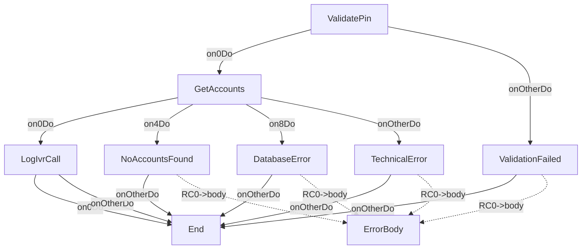

# GetClientAccountsOp

---
entity_type: operation
entity_id: GetClientAccountsOp
conversion_status: not_started
entry_step: ValidatePin
channel: IVR
host_key: GCAC
source_file: C:\GitHub\shaybc\snapir\bank-demo\composer\Workspace\WSBCC_IVR\src\Xml Definition\Channel\IVR\selfDefOper\GetClientAccounts.xml
source_hash: 9dcc938f33cbdec98354dbeb023d9574ed8f2df9476a13e128ee8f7b171d76dc
---

## Context
- [GetClientAccountsCtxt](contexts/GetClientAccountsCtxt.md)

## Shared Components
- 3 shared components
- format StandardErrorRSFmt: [StandardErrorRSFmt](formats/StandardErrorRSFmt.md)
- implClass com.ibm.il.dse.operations.common.ValidateInputFields: [com.ibm.il.dse.operations.common.ValidateInputFields](classes/com/ibm/il/dse/operations/common/ValidateInputFields.md)
- implClass com.ibm.il.dse.operations.common.MapErrorByValueAlways: [com.ibm.il.dse.operations.common.MapErrorByValueAlways](classes/com/ibm/il/dse/operations/common/MapErrorByValueAlways.md)

## Operation Attributes
- operationFields: `CHANNEL_ID=IVR`
- writeToLog: `true`

## Steps
- [ValidatePin](opsteps/ValidatePin.md)
- [GetAccounts](opsteps/GetAccounts.md)
- [LogIvrCall](opsteps/LogIvrCall.md)
- [NoAccountsFound](opsteps/NoAccountsFound.md)
- [ValidationFailed](opsteps/ValidationFailed.md)
- [DatabaseError](opsteps/DatabaseError.md)
- [TechnicalError](opsteps/TechnicalError.md)

## Request Format
- [GetClientAccountsIvrRQFmt](formats/GetClientAccountsIvrRQFmt.md)

## Reply Format
- [GetClientAccountsIvrRSFmt](formats/GetClientAccountsIvrRSFmt.md)

## Other Formats
- csErrorReplyFormat: [StandardErrorRSFmt](formats/StandardErrorRSFmt.md)

## Java Dependencies
- [com.ibm.il.dse.operations.common.ValidateInputFields](classes/com/ibm/il/dse/operations/common/ValidateInputFields.md)
- [com.ibm.il.dse.operations.ivr.db.GetClientAccountsIvrSP](classes/com/ibm/il/dse/operations/ivr/db/GetClientAccountsIvrSP.md)
- [com.ibm.il.dse.operations.ivr.db.LogIvrSession](classes/com/ibm/il/dse/operations/ivr/db/LogIvrSession.md)
- [com.ibm.il.dse.operations.common.MapErrorByValueAlways](classes/com/ibm/il/dse/operations/common/MapErrorByValueAlways.md)
- [com.ibm.il.dse.operations.common.MapErrorByValueAlways](classes/com/ibm/il/dse/operations/common/MapErrorByValueAlways.md)
- [com.ibm.il.dse.operations.common.MapErrorByValueAlways](classes/com/ibm/il/dse/operations/common/MapErrorByValueAlways.md)
- [com.ibm.il.dse.operations.common.MapErrorByValueAlways](classes/com/ibm/il/dse/operations/common/MapErrorByValueAlways.md)

## Flow Diagram

